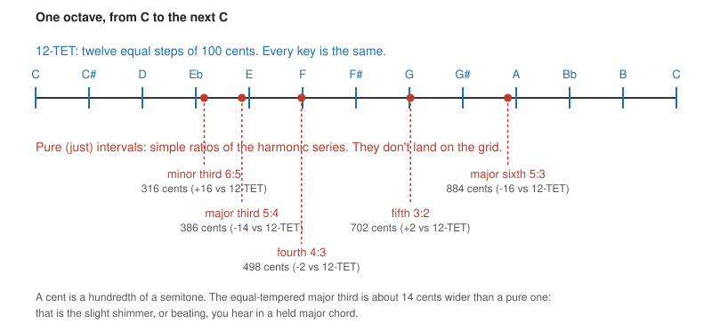
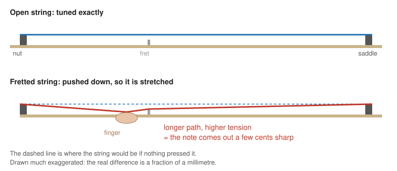
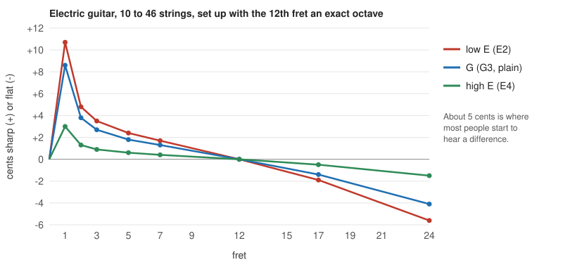
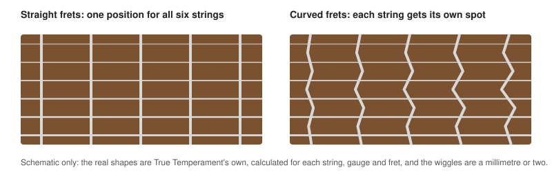
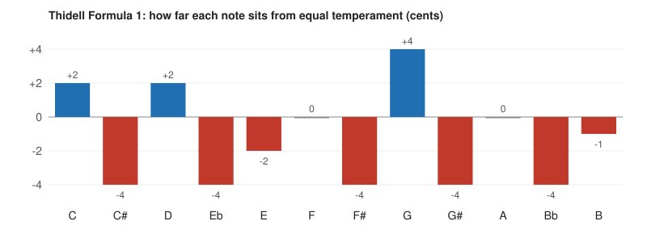

# Temperament plugin

OxiGuitar's sound plugins play every note at its exact textbook pitch. A real guitar never does: its notes drift a few hundredths of a semitone sharp or flat depending on the string and the fret. This plugin makes a guitar or bass track play the way a real instrument would, or the way a guitar with True Temperament frets would.

It changes only what you hear. The score, the tablature and the saved file stay exactly as written. You pick it per track, in the track dialog's **Temperament** section ([How to use it](use-cases.md) shows where).

The effect is small, a few cents, which is why this page spends a while on what a cent is and why any of it matters. If you just want to try it, skip to [How to use it](use-cases.md).

## Notes, frequencies and cents

Every note is a frequency: the A string of a guitar vibrates 110 times a second, the A an octave up 220 times, the next 440. An octave is always a doubling. The question is how to split that doubling into the twelve notes we play.

Musicians measure small differences in **cents**: a hundredth of a semitone. Twelve semitones make an octave, so an octave is 1200 cents. Most people start to hear a difference somewhere around 5 cents between two notes played one after the other, and much less when they are held together, because two notes slightly out of tune with each other "beat": the sound wobbles in volume.

## Pure intervals, and why they don't fit

When a string vibrates it doesn't make one frequency but a whole stack of them, the **harmonic series**: the note itself, twice it, three times, four times, five times and so on. Two notes sound smooth together when their harmonics line up, and that happens when their frequencies are a simple ratio:

- an octave is 2:1
- a fifth (C to G) is 3:2
- a fourth (C to F) is 4:3
- a major third (C to E) is 5:4
- a minor third (E to G) is 6:5

Intervals tuned to these exact ratios are called **pure** or **just**. Tuning that uses only pure intervals is **just intonation**, and it is the sweetest-sounding tuning there is, for one chord at a time.

The trouble is that the ratios don't add up. Stack twelve pure fifths, and you should land back on the note you started from, seven octaves up. You don't: you overshoot by about 23.5 cents, a gap called the Pythagorean comma. Pure thirds have the same problem. There is no way to give an instrument with fixed notes (a piano, or a guitar with frets) pure intervals in every key. Something has to give, and how you share out that error is called a **temperament**.

## Equal temperament and 12-TET

**Equal temperament** shares the error out as evenly as possible: the octave is cut into steps that are all exactly the same size. With twelve steps it is called **12-TET** (twelve-tone equal temperament) or 12-EDO, and every step is a semitone of exactly 100 cents. Each frequency is the one before it times the twelfth root of two, about 1.0595.

It exists because it makes every key the same. A song can be played in E or in F, can change key halfway through, and the guitar can play with a piano, and it all works, with nothing to retune. It is also what makes straight frets possible: one fret serves all six strings. The cost is that no interval except the octave is pure. Fifths are 2 cents narrow, which nobody notices; major thirds are about 14 cents wide, which you can hear as a slight shimmer in a long, held major chord.

The idea was worked out independently by Zhu Zaiyu in China in 1584 and by Simon Stevin in the Low Countries in 1585. It took two centuries to win: Europe's keyboards moved to it during the late 1700s and 1800s. Today it is the standard tuning of almost all Western music, and the one every synthesizer and every MIDI sound set plays.

## Why a guitar doesn't play the notes exactly

Frets are placed for an ideal string, one with no thickness that only vibrates. Real strings aren't ideal, and two things move a fretted note away from where the fret means it to be:

- **Stretching.** To play a note you press the string down to the fret. The string now runs from the nut, down under your finger, over the fret and back up to the saddle: a slightly longer path than when it was open. A longer, stretched string is tighter, and a tighter string plays sharper.
- **Stiffness.** A real string is a thin metal rod, and it resists bending. That stiffness makes it vibrate a little sharp, and more so the shorter the vibrating part is. Thick wound strings and the plain G of an electric set are the worst.

A guitar's **intonation** setup (moving each saddle back a little, the screws at the bridge) fixes the 12th fret so that it is an exact octave. It can't fix every fret at once. On a typical electric guitar the result is that the first frets play up to about 11 cents sharp on the low strings, the middle of the neck is nearly right, and the highest frets end up a few cents flat:

This chart is what the plugin's **Realistic guitar** mode plays. The numbers come from its model of the string, described in [Architecture and strategy](how-it-works.md).

## Perfect temperament

"Perfect temperament" usually means giving up on a fixed tuning altogether and playing every chord in just intonation: each interval pure, adjusted chord by chord to fit the key and the harmony. Singers, string quartets, trombones and fretless instruments do something like this by ear all the time. A guitar with frets can't, because its frets are glued in place.

A computer isn't stuck with frets, so OxiGuitar could one day play a score this way. It isn't built yet: what it should do exactly (by key, by the way a note is spelled, chord by chord) is still being decided, and it is listed under [what's left out](how-it-works.md#left-out-on-purpose).

## True Temperament and Thidell's formula

**True Temperament** is a fretting system from the Swedish company of the same name. Its frets aren't straight: each one is bent into a wiggle, so that under every string it sits exactly where that string needs it. The system was invented by Anders Thidell, who spent more than 15 years on it. His first idea used 31 curved frets per octave. In 2005 he teamed up with the guitar builder Paul Guy, who convinced him to keep the twelve notes per octave every guitarist knows.

The curved frets fix two things at once:

1. **The stretching and stiffness errors** above, string by string and fret by fret. With straight frets nothing can.
2. **The temperament itself.** The frets aren't aimed at equal temperament but at **Thidell Formula 1**, a temperament Thidell designed for the guitar. It is a *well temperament*, the family of tunings Bach's *Well-Tempered Clavier* belongs to: all twelve keys work, but the common ones are sweeter. Each note is nudged by at most 4 cents from equal temperament, which makes the thirds purer in the keys guitarists play most.

The open strings are tuned to match: E −2, A 0, D +2, G +4, B −1 and E −1 cents. Players tune them with a tuner that has Thidell presets; Peterson's strobe tuners do.

The plugin's **True Temperament: Thidell Formula 1** mode plays the notes as a perfectly built True Temperament neck would: every fret exactly on its Formula 1 target.

## Who plays what

True Temperament necks are played by, among others, Steve Vai, Steve Lukather, John Petrucci, Steve Morse, Mattias IA Eklundh (an advocate since 2008), Fredrik Thordendal of Meshuggah, Per Nilsson of Scar Symmetry and Plini, and, according to the company, Nuno Bettencourt recorded acoustics fitted with it on an Extreme album. One of Anders Thidell's last jobs was converting Brian May's Tokai Hummingbird acoustic to the system.

Equal temperament on the guitar is the norm, not a law of nature, and plenty of players went another way:

- **Renaissance and Baroque lutenists and viol players** tied their frets of gut and could move them. Many of the best tuned in one of the *meantone* temperaments, which favour pure thirds in the common keys.
- **J. S. Bach**'s *Well-Tempered Clavier* (1722) was written for a well temperament, not today's equal one.
- **Harry Partch** built his own instruments, two Adapted Guitars among them, for his 43-note scale in just intonation.
- **Jon Catler** plays blues and rock in just intonation on refretted guitars, with his band Willie McBlind.
- **King Gizzard & the Lizard Wizard** went the other way, to *more* equal steps: from *Flying Microtonal Banana* (2017) on, they refretted guitars and basses for 24-tone equal temperament, with quarter tones between the usual notes.

## In short

| Mode | What you hear |
| --- | --- |
| **Off (equal temperament)** | Every note exactly in 12-TET, as every sound plugin plays it. The default. |
| **Realistic guitar** | A real guitar's small errors: sharp near the nut, flat high up. Pick nylon, steel, electric or bass, or let the track's instrument decide. |
| **True Temperament: Thidell Formula 1** | A perfect True Temperament neck: every fret on its Thidell Formula 1 target, open strings tuned to match. |

The effect is subtle. It is a matter of taste and of curiosity more than of correction.
