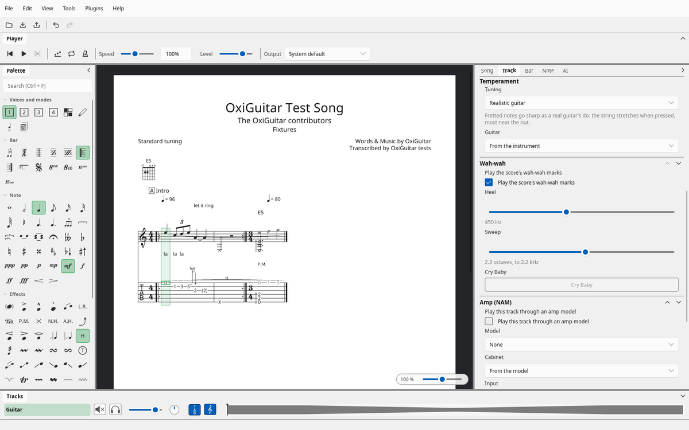
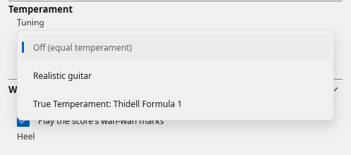
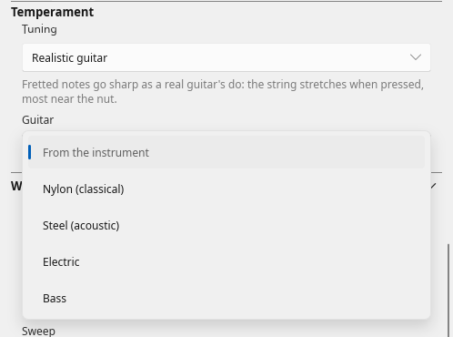
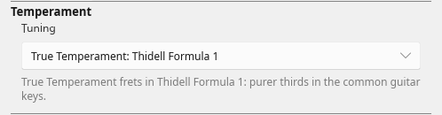

# How to use it

## Pick a temperament for a track

1. Open a song, and click any note of the guitar or bass track you want to change. The right-hand panel follows the track you are in.
2. Choose the **Track** tab on the right.
3. Scroll down to the **Temperament** section. It only shows for fretted tracks: guitars, basses, banjo and sitar.

4. Open **Tuning** and pick one of the three modes:

5. Press Play. The change applies the next time the song starts playing, and it is saved with the song.

## Hear a real guitar's intonation

Pick **Realistic guitar**. A second list, **Guitar**, picks which kind of instrument is modelled:

- **From the instrument**, the default, follows the track's instrument: a nylon-string guitar plays as nylon, an electric as electric, a bass as bass, anything else as steel.
- **Nylon**, **Steel**, **Electric** or **Bass** force one, for example to hear an acoustic part as it would sound on an electric.

Fretted notes then come out a little sharp near the nut and a little flat high up the neck, as on a real, well set-up guitar ([why](index.html#why-a-guitar-doesnt-play-the-notes-exactly)). Open strings, natural harmonics and dead notes stay as written.

## Hear True Temperament frets

Pick **True Temperament: Thidell Formula 1**:

Every note moves to its Thidell Formula 1 pitch, at most 4 cents from equal temperament, and the open strings are tuned to match. Major chords in the common guitar keys (E, A, D, G, C) ring a touch smoother. Hold a chord and compare it with **Off**.

## Go back to normal

Pick **Off (equal temperament)**, the default. Every note plays exactly as written, as with any other sound plugin.

## Good to know

- The effect is a few cents. It is easiest to hear on long, held chords with a clean sound, and on two notes ringing together.
- Bends, slides and vibrato keep their shape: the whole note is moved, curve and all.
- A capo counts as a fret, just as on a real guitar.
- It changes only what you hear. The score, the tablature and the saved `.gp` or other file are untouched; the choice is kept in the song's `.oxg` file beside it.
- It also applies to audio exports, if you have the audio export plugin.
